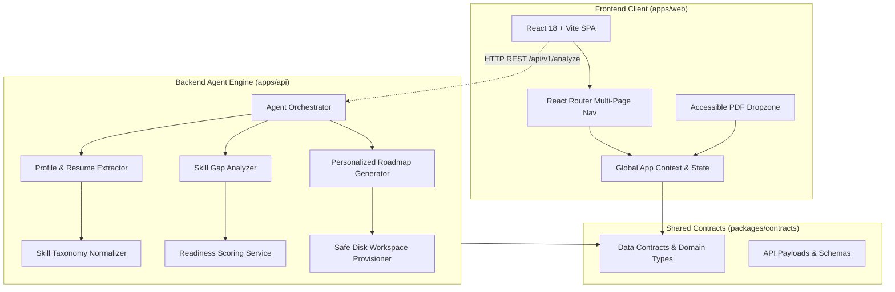

# CareerAgent AI — System Architecture & Design Specification

> **Project Code:** AF-03  
> **Application Name:** CareerAgent AI (CareerMatch)  
> **Document Version:** 1.0.0  
> **Target Audience:** Engineering, Product, UI/UX, and Hackathon Evaluation  

---

## 1. Executive Summary & Purpose

**CareerAgent AI** is an AI-powered Career and Skill-Gap Intelligence platform designed to bridge the chasm between candidate qualifications and market job requirements. 

Unlike conventional keyword-matching applicant tracking systems (ATS), CareerAgent AI implements an **end-to-end agentic workflow**:
1. **Resume & Profile Extraction**: Ingestion of candidate resumes (PDF format) and professional profile descriptors.
2. **Taxonomy-Driven Semantic Normalization**: Extraction of concrete skills across 60+ categorized domains with alias resolution.
3. **Target Job Comparison**: Systematic matching against specific job postings or dynamic market requirements.
4. **Explainable Readiness Scoring**: Transparent, weighted readiness scoring based on core and secondary skill coverage.
5. **Personalized Actionable Roadmap**: Tailored weekly milestones, curated resource recommendations, and automated disk-based study workspaces.

---

## 2. System Architecture

The application is structured as a modular TypeScript monorepo with clean separation between shared contracts, frontend client applications, and backend agent services.



### Directory Structure & Workspaces

```text
TEAMANJOORANSYNDICATE_VYUHAM26/
├── apps/
│   ├── api/                     # Node.js + Express Agent Pipeline
│   │   └── src/
│   │       ├── agent/           # Extractor, Normalizer, Gap Analyzer, Roadmap Gen
│   │       ├── controllers/     # REST Controllers
│   │       ├── repositories/    # In-memory & Mock Persistence Repos
│   │       ├── services/        # Readiness & Progress Services
│   │       └── tools/           # Workspace & File Generation Tools
│   └── web/                     # React 18 + Vite Multi-Page Frontend
│       └── src/
│           ├── components/      # Sidebar, Topbar, Modals, CareerAgent UI Components
│           ├── context/         # Application Context (File, JD, Analysis Results)
│           ├── layouts/         # Dashboard Shell Layout
│           ├── pages/           # Dedicated route views (Home, Analysis, Roadmap, etc.)
│           ├── services/        # Frontend API client & mock prototype fallback
│           └── styles/          # CareerAgent design tokens & responsive CSS
├── packages/
│   └── contracts/               # Shared TypeScript schemas, DTOs, and interfaces
├── package.json                 # Monorepo Workspace Configuration
└── design.md                    # This Design Specification
```

---

## 3. UI/UX Design System & Visual Tokens

The user interface follows a modern, professional, distraction-free SaaS design system characterized by clean white surfaces, pale blue accents, high-contrast dark navy typography, and restrained alert states.

### 3.1 Color Palette & Semantic Tokens

| Token | Hex Value | Semantic Role |
| :--- | :--- | :--- |
| **Primary Blue** | `#1677FF` | Primary action buttons, active navigation pills, progress bars, active border states |
| **Primary Blue Hover** | `#0F63D8` | Hover and active interactive state for primary controls |
| **Subtle Blue** | `#EEF6FF` | Selected navigation items, icon wrapper backgrounds, dragover dropzone highlights |
| **Page Background** | `#F8FAFC` | Main canvas background, dropzone idle background |
| **Surface** | `#FFFFFF` | Cards, sidebars, topbar, modal backgrounds |
| **Borders & Dividers**| `#E6ECF3` | Card borders, table dividers, input outlines |
| **Navy Text (Heading)**| `#101828` | Main page titles, card headers, high-emphasis text |
| **Body Text** | `#344563` | Paragraphs, navigation labels, list items |
| **Muted Text** | `#667085` | Supporting descriptions, timestamps, secondary metadata, placeholders |
| **Success Green** | `#12A879` | Positive skill match badges, upload ready indicator, high readiness status |
| **Alert Red** | `#EF4444` | Critical skill gap warnings, delete actions, validation errors |
| **Soft Red** | `#FFF1F2` | Background badges for missing critical skills and error containers |

### 3.2 Typography Scale

* **Primary Font Stack**: Inter, system-ui, -apple-system, BlinkMacSystemFont, "Segoe UI", Roboto, sans-serif.
* **Hero Heading**: `28px – 32px` (Mobile) / `36px – 44px` (Desktop), Bold (`font-weight: 700`), Line-height: `1.2`.
* **Section Heading**: `20px – 24px`, Semi-bold (`font-weight: 600`), Line-height: `1.3`.
* **Card Heading**: `15px – 17px`, Semi-bold (`font-weight: 600`).
* **Body Text**: `14px – 15px`, Regular (`font-weight: 400`), Line-height: `1.5`.
* **Captions & Metadata**: `12px – 13px`, Regular to Medium, Muted color (`#667085`).

### 3.3 Layout & Spacing Principles

* **Spacing Grid**: Multiples of 4px/8px (`4px`, `8px`, `12px`, `16px`, `24px`, `32px`, `48px`).
* **Corner Radius**:
  * Micro (tags, pills, buttons): `6px` – `8px` (`var(--radius-sm)` / `var(--radius-md)`)
  * Standard Cards: `12px` (`var(--radius-lg)`)
  * Panels & Modals: `16px` – `20px` (`var(--radius-xl)`)
* **Shadows**: Subtle, low-opacity elevation (`0 1px 3px rgba(16, 24, 40, 0.05)`). Avoid heavy, dark drop shadows.

---

## 4. Multi-Page Information Architecture

To prevent visual crowding and cognitive overload, features are decoupled into distinct, dedicated routes rather than crammed into a single view:

```text
/                      -> Dashboard Overview (Summary metrics, workflow intro, quick CTA)
/resume-analysis       -> Focused 2-Step Analysis Wizard (Upload Resume -> Target Job)
/analysis-results      -> Detailed Intelligence Report (Match score, skill breakdowns, recommendations)
/job-matching          -> Role Exploration & Real-Time Job Market Alignments
/skill-gaps            -> Deep-Dive Gap Matrix (Possessed, Partial, and Critical Missing)
/learning-roadmap      -> Week-by-Week Milestones, Guided Exercises, and Proof of Work
/saved                 -> Bookmarked Job Roles, Learning Modules, and Notes
/settings              -> User Profile, Notification Preferences, and API Keys
```

### 4.1 Shell Layout Architecture (`DashboardLayout.tsx`)

The persistent application shell consists of:
* **Left Sidebar**:
  * Brand badge with custom icon and "CareerAgent" header.
  * Primary navigation items (`Home`, `Resume Analyzer`, `Job Matching`, `Skill Gaps`, `Learning Roadmap`, `Saved`).
  * Active indicator: Soft blue pill background (`#EEF6FF`), royal blue icon/label (`#1677FF`), clean left active accent bar.
  * Bottom pinned section for `Settings`.
* **Sticky Topbar**:
  * Global search input with placeholder `"Search for jobs, skills or roles..."`.
  * Notification toggle button with unread indicator badge.
  * Profile avatar control.
  * Mobile hamburger trigger for responsive viewport drawer toggle.
* **Centered Main Content Area**:
  * Max-width containment (`max-w-6xl` / `1200px`) with responsive horizontal padding.

---

## 5. Detailed Component Specifications

### 5.1 Resume Upload Component (`ResumeUpload.tsx`)

The Resume Upload component handles user document ingestion with strict validation and visual feedback.

#### States:
1. **Empty Upload Dropzone**:
   * A full-width dropzone with a 2px dashed border (`#CBD5E1`) on a pale background (`#F8FAFC`).
   * Centered circular icon container (`50px × 50px`) in soft blue (`#EEF6FF`) containing the `IconUploadCloud` icon (`#1677FF`).
   * Primary prompt: `"Drag and drop your resume here"`.
   * Action link: `"or click to browse"`.
   * Constraints label: `"PDF only · Maximum size 10 MB"`.
   * Dragover state: Instant visual highlight with `#EEF6FF` background and `#1677FF` border.
   * Completely hidden native `<input type="file" />` with accessible keyboard and click event proxying.
2. **Selected File Card**:
   * Replaces the dropzone upon successful file selection.
   * Compact, horizontal structured card (`padding: 16px 20px; border-radius: 12px; border: 1px solid #E6ECF3`).
   * **Left section**:
     * Red PDF document icon inside a soft red container (`#FFF1F2`).
     * Real filename in bold navy (`font-weight: 600; color: #101828`), gracefully truncated via ellipsis (`text-overflow: ellipsis; max-width: 420px`).
     * Real computed size subtitle (e.g., `PDF document · 245 KB`).
   * **Right section**:
     * Success tag: `✓ Ready for Analysis` in green (`#12A879`).
     * Remove button with trash icon: Resets file state and restores empty dropzone.
3. **Validation & Errors**:
   * Immediate inline alerts for non-PDF extensions/MIME types and files > 10MB.

### 5.2 Two-Step Stepper Workflow (`ResumeAnalysisPage.tsx`)

* **Step 1: Resume Upload**: Focuses entirely on candidate document ingestion. The bottom "Continue to Step 2" action remains disabled until a valid PDF is uploaded.
* **Step 2: Target Job Description**:
  * Displays an "Attached Resume" reminder pill at the top with a "Change Resume" shortcut.
  * Multiline textarea for job posting requirements.
  * "Quick Fill" presets (e.g., "Full-Stack Role", "DevOps Role") to allow rapid evaluation without external copy-pasting.
  * "Analyze Resume" primary CTA that triggers the analysis pipeline.

### 5.3 Analysis Results Hub (`AnalysisResultsPage.tsx`)

Displays the multi-dimensional output of the evaluation:
1. **Overall Match Score Card**: Circular or prominent progress indicator showing percentage match (e.g., `78% - Strong Candidate Potential`).
2. **Readiness Assessment**: Qualitative summary of key strengths, primary risks, and recommended timeline.
3. **Skills Breakdown**:
   * **Matched Skills** (Green tags with context where found).
   * **Partially Matched Skills** (Amber/Blue tags detailing missing depth).
   * **Missing Skills** (Red tags highlighting critical roadblocks).
4. **Actionable Suggestions**: Specific resume bullet improvements and technical learning tasks.

---

## 6. Backend Intelligence Engine Architecture

The backend (`apps/api`) features a deterministic, explainable career analysis pipeline:

### 6.1 Extraction & Normalization
* **`ProfileExtractor`**: Parses text from profile bios and uploaded resume strings.
* **`SkillNormalizer`**: Employs a canonical taxonomy across 60+ industry standards:
  * Languages: JavaScript, TypeScript, Python, Java, Go, Rust, SQL, etc.
  * Frameworks: React, Next.js, Node.js, Express, FastAPI, Django, Spring Boot.
  * Infrastructure: Docker, Kubernetes, AWS, CI/CD Pipelines, Terraform.
  * Tools & Databases: PostgreSQL, MongoDB, Redis, Git, Jest.
  * Word-boundary regex matching ensures exact alias detection (e.g., matching `k8s` to `Kubernetes (K8s)`).

### 6.2 Explainable Readiness Algorithm (`readiness.service.ts`)
* Evaluates weighted score based on:
  $$\text{Readiness Score} = \left(\frac{\text{Matched Required Skills}}{\text{Total Required Skills}} \times 0.7\right) + \left(\frac{\text{Partial Matches}}{\text{Total Required Skills}} \times 0.2\right) + \text{Evidence Bonus (up to 0.1)}$$
* Produces transparent, explainable breakdowns rather than non-deterministic black-box LLM predictions.

### 6.3 Automated Disk Workspace Creation (`workspaceTool.ts`)
* When a learning roadmap is generated, the agent provisions a real sandbox on the local file system with:
  * Structured milestone folders (e.g., `Week-01-Docker-Fundamentals/`, `Week-02-Kubernetes-Basics/`).
  * `README.md` project briefs, curated learning links, and starter files.

---

## 7. Accessibility, Responsiveness & Verification

### 7.1 Accessibility (a11y)
* Semantic HTML5 tags (`<main>`, `<nav>`, `<aside>`, `<header>`, `<footer>`, `<section>`).
* Interactive elements have explicit `aria-label` tags and visible keyboard focus states (`focus-visible`).
* Colors meet WCAG AA contrast ratios (minimum 4.5:1 for normal body text against backgrounds).

### 7.2 Responsive Adaptations
* **Desktop (`≥ 1024px`)**: Fixed 260px sidebar, flexible content container, multi-column metric layouts.
* **Tablet (`768px – 1023px`)**: Compact sidebar or collapsible drawer, wrapping metric grids.
* **Mobile (`< 768px`)**: Off-canvas hamburger navigation drawer, stacked single-column cards, full-width touch-friendly buttons (minimum tap target 44px).

### 7.3 Build & Quality Gates
* **Linting / Type-Checking**: Executed via TypeScript compiler without extraneous dependencies:
  ```bash
  npm run lint --workspace=@af03/web
  ```
* **Production Build**: Standardized Vite bundle compilation:
  ```bash
  npm run build --workspace=@af03/web
  ```
* **Automated Test Suite**: Regression suite verifying all agent modules:
  ```bash
  npm test
  ```

